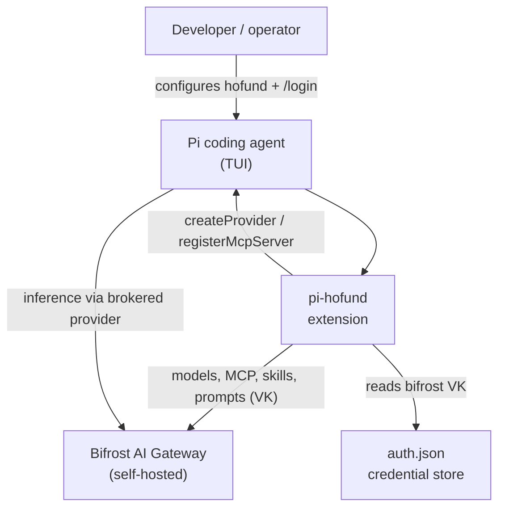
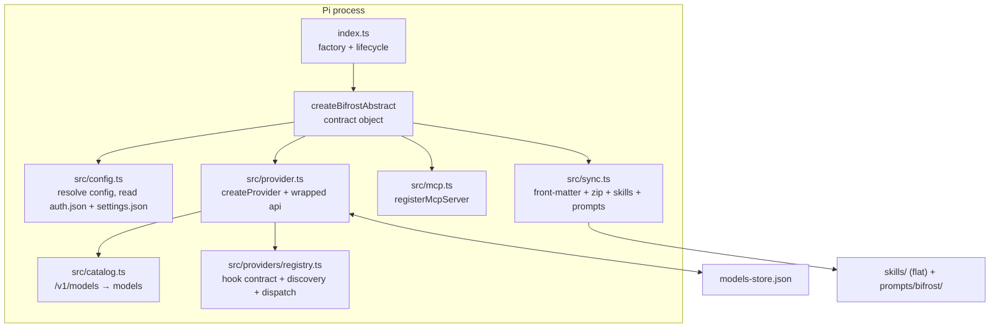

# Architecture — pi-hofund

Spec-driven notes and C4 diagrams. `docs/ATLAS.md` is the authoritative grounding document; this file records the shape and its assertions.

## Spec assertions

- [x] Provider id is `bifrost`; `defaultProvider` and `enabledModels` are unchanged in `settings.json`.
- [x] The virtual key is read from `auth.json` (`src/credential.ts`), never from the environment or `settings.json`.
- [x] `mcp`, `skills`, and `prompts` are opt-in and default OFF; only `models` is always on.
- [x] Model fields derive from the rich `/v1/models` catalog with no fallbacks or magnitude heuristics.
- [x] `refreshModels` restores the stored catalog, honors a TTL, coalesces concurrent refreshes, and performs no network work in the request path.
- [x] Skills and prompts materialize atomically and clean up only manifest-tracked files.
- [x] Per-upstream overrides are auto-discovered from `src/providers/*.ts`; `shared/**` is excluded.
- [x] Zero runtime dependencies; Vitest covers every module.
- [x] CI (`.github/workflows/ci.yml`) runs `npm test` (Vitest) on every push to `main` and publishes via a tag/`workflow_dispatch`-guarded `npm publish` job with `NODE_AUTH_TOKEN`.

## C4 Level 1 — System Context

## C4 Level 2 — Container

